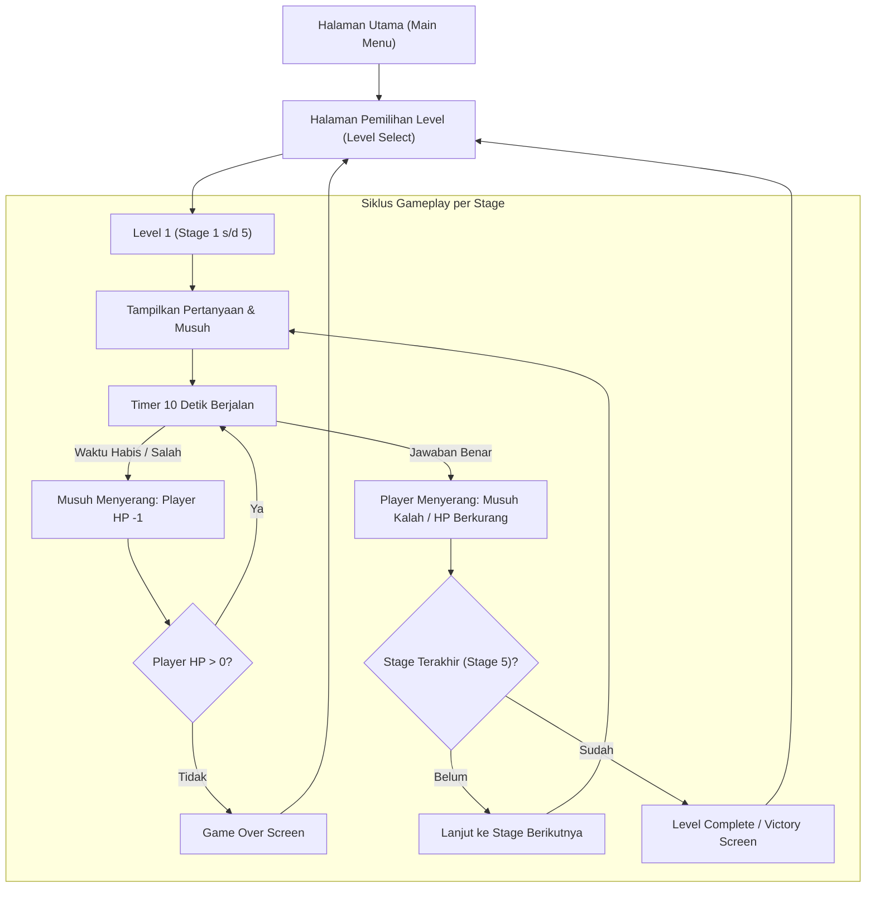

# Game Design Document & Perencanaan Awal: "Logic Defender"
**Mata Kuliah**: Berpikir Komputasi (Bekom)  
**Tech Stack**: Native HTML5, CSS3, Vanilla JavaScript (ES6+) — Tanpa Framework  

---

## 1. Konsep & Tujuan Game

Game edukasi berbasis web interaktif bertema petualangan logika pemrograman (*Logic Battle*). Pemain berperan sebagai karakter yang harus mengalahkan musuh/monster di setiap stage dengan cara melengkapi potongan kode/logika (*fill-the-blank*). 

Keterkaitan dengan **4 Pilar Berpikir Komputasi**:
1. **Dekomposisi**: Memecah masalah kode besar menjadi bagian baris perintah spesifik.
2. **Pengenalan Pola**: Memahami pola sintaks, iterasi, dan kondisi logika.
3. **Abstraksi**: Mengabaikan kompleksitas berlebih dan berfokus pada bagian yang kosong (*blank*).
4. **Algoritma**: Menyusun alur eksekusi logika yang benar agar program berjalan sukses.

---

## 2. Alur Navigasi & Game State (Game Flow)

Game dirancang sebagai **Single Page Application (SPA)** murni menggunakan pergantian section/div di HTML.



---

## 3. Mekanik Inti Gameplay (Core Mechanics)

### A. Sistem Nyawa (Health Points / HP)
- **Player HP**: Default **3 atau 5 HP** (direpresentasikan dengan ikon hati ❤️).
- **Enemy HP**: Tiap stage memiliki 1 monster (misal 1 HP per stage, atau 2-3 HP di boss stage 5).

### B. Mekanik Musuh & Timer 10 Detik
- Ketika stage dimulai, countdown timer 10 detik langsung aktif.
- Visualisasi: Progress bar waktu yang berkurang dari hijau ke merah.
- **Kondisi Penalti**:
  - Jika waktu mencapai `0` detik: Monster melakukan animasi serang, Player terkena damage (-1 HP), timer di-reset ke 10 detik untuk memberi kesempatan menjawab lagi (atau pindah ke soal berikutnya).
  - Jika pemain menjawab salah: Muncul peringatan visual "Salah!", dan timer dapat dikurangi penalti (opsional) atau langsung memicu serangan musuh.

### C. Sistem Input "Fill the Blank"
Ada 2 opsi interaksi yang ramah pengguna:
- **Opsi 1 (Button Click / Word Bank)**: Pemain disajikan beberapa opsi tombol pilihan (misal 3-4 pilihan) untuk mengisi titik-titik `___`. (Sangat direkomendasikan untuk game cepat bertimer 10 detik).
- **Opsi 2 (Text Input)**: Input teks manual. Kurang ideal untuk timer 10 detik karena risiko typo dan lambat mengetik di HP/keyboard.

---

## 4. Rincian Materi Level 1 (5 Stages)

Level 1 difokuskan pada pengenalan dasar berpikir komputasi & logika pemrograman:

| Stage | Topik Berpikir Komputasi | Bentuk Kasus / Soal | Contoh Logika (*Fill the blank*) |
| :--- | :--- | :--- | :--- |
| **Stage 1** | Variabel & Penugasan Nilai | Menginisialisasi darah pemain | `let player_hp = ___;` *(Pilihan: 100 / "batu" / false)* |
| **Stage 2** | Operasi Komparasi / Perbandingan | Mengecek apakah kunci pintu sudah cukup | `if (kunci ___ 3) { bukaPintu(); }` *(Pilihan: == / = / <)* |
| **Stage 3** | Percabangan Logika (If-Else) | Menentukan arah jalan pahlawan | `if (musuhDiDepan) { serang(); } ___ { maju(); }` *(Pilihan: else / then / loop)* |
| **Stage 4** | Perulangan (Looping Pattern) | Mengambil 5 koin emas di dungeon | `for (let i = 0; i < 5; i___) { ambilKoin(); }` *(Pilihan: ++ / -- / ==)* |
| **Stage 5 (Boss)** | Gerbang Logika Kombinasi (AND / OR) | Membuka mantra segel naga | `if (punyaPedang ___ punyaPerisai) { serangNaga(); }` *(Pilihan: && / \|\| / !)* |

---

## 5. Arsitektur Struktur Folder & File

Untuk menjaga kode tetap bersih, modular, dan mudah dikembangkan:

```
project_akhir/
├── index.html            # Halaman tunggal (berisi kontainer Main, Level, Game, Modal)
├── css/
│   ├── style.css         # Styling global, typography, layout grid/flexbox
│   └── game.css          # Animasi battle, visual health bar, timer progress bar
├── js/
│   ├── data/
│   │   └── questions.js  # Bank soal, kunci jawaban, dan data musuh per stage
│   ├── modules/
│   │   ├── timer.js      # Pengatur countdown 10 detik & callback saat habis
│   │   ├── ui.js         # Render elemen DOM (update HP, render soal, popup)
│   │   └── audio.js      # Efek suara (opsional: serang, kena pukul, menang)
│   └── app.js            # Controller utama / Game Engine & State Management
└── assets/
    ├── images/           # Avatar player, sprite monster stage 1-5, background
    └── audio/            # Sound effects / BGM ringan (opsional)
```

---

## 6. Model Data Pertanyaan (`questions.js`)

Struktur objek JavaScript untuk menyimpan level dan stage:

```javascript
export const gameData = {
  level1: {
    id: 1,
    name: "Dasar Logika & Algoritma",
    stages: [
      {
        stageNumber: 1,
        enemyName: "Bug Slime",
        enemyHp: 1,
        enemySprite: "assets/images/slime.png",
        questionText: "Lengkapi kode untuk menyimpan jumlah nyawa pahlawan!",
        codeSnippet: "let player_health = ___ ;",
        options: ["100", "'mati'", "false", "undefined"],
        correctAnswer: "100",
        hint: "Nyawa direpresentasikan dengan angka (integer)."
      },
      // Stage 2 s/d 5 ...
    ]
  }
};
```

---

## 7. Rencana Roadmap Pengerjaan (Milestones)

- [ ] **Milestone 1: Setup Kerangka & Mockup UI**  
  Membuat struktur `index.html` dengan section Menu Utama, Pilihan Level, dan Arena Game.
- [ ] **Milestone 2: Modul Timer & HP Player/Enemy**  
  Implementasi countdown 10 detik dengan interval JS, sistem kurangi darah player saat timeout.
- [ ] **Milestone 3: Mesin Pertanyaan & Validasi Jawaban**  
  Render soal dari array data, pengecekan jawaban benar/salah, pemicu serangan player vs monster.
- [ ] **Milestone 4: Transisi Stage & Game State (Game Over / Victory)**  
  Menangani perpindahan dari Stage 1 hingga Stage 5, kondisi menang jika Stage 5 kelar, atau kalah jika HP = 0.
- [ ] **Milestone 5: Visual Styling, Sprite, & Feedback Visual**  
  Menambahkan animasi goyang/merah saat monster memukul, progress bar timer, dan efek transisi.
