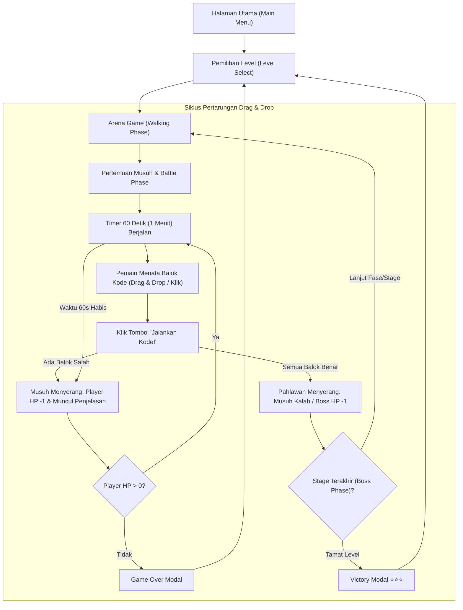

# Game Design Document: "Python Quest — Logic Battle"
**Mata Kuliah**: Berpikir Komputasi (Bekom)  
**Tech Stack**: Native HTML5, CSS3, Vanilla JavaScript (ES6+) — Multi-Page Application (MPA)

---

## 1. Konsep & Tujuan Game

Game edukasi berbasis web interaktif bertema petualangan pahlawan logika Python (*Code Puzzle Drag & Drop*). Pemain berperan sebagai pahlawan yang menjelajahi 3 dunia (Forest, Cave, Volcano) dan menghadapi monster di setiap stage dengan cara menyelesaikan puzzle kode Python yang rumpang (*Fill-in-the-Blank*).

Keterkaitan dengan **4 Pilar Berpikir Komputasi**:
1. **Dekomposisi**: Memecah blok program Python yang utuh ke dalam token-token komponen (pernyataan kondisi, pemanggilan fungsi, operator perbandingan, kata kunci percabangan).
. **Pengenalan Pola**: Mengenali struktur baku percabangan (`if...else`), sintaks fungsi (`def...return`), dan iterasi perulangan (`for...in range`).
3. **Abstraksi**: Mengidentifikasi variabel penentu keputusan dan menyaring balok kode yang tidak relevan (pengecoh).
4. **Algoritma**: Menyusun balok-balok kode dalam urutan eksekusi yang valid agar program menghasilkan luaran yang diharapkan.

---

## 2. Alur Navigasi & Game State (Game Flow)

Game dirancang sebagai **Multi-Page Application (MPA)** dengan tiga halaman utama:

- `index.html` — halaman awal / menu utama
- `levels.html` — halaman pemilihan level
- `game.html` — halaman pertarungan + cutscene (prolog, antar-level, epilog)

Progress level dan posisi stage disimpan otomatis, sehingga refresh halaman tidak mengulang permainan dari awal.



---

## 3. Mekanik Inti Gameplay (Core Mechanics)

### A. Sistem Nyawa (Health Points / HP)
- **Player HP**: Memiliki **3 Nyawa ❤️❤️❤️**.
- **Enemy HP**: Musuh reguler memiliki 1 HP. Musuh **Boss** memiliki 3 HP (membutuhkan 3 fase tantangan kode berturut-turut).

### B. Countdown Timer 60 Detik (1 Menit)
- Setiap soal memberikan waktu **60 detik (1 menit)** agar pemain memiliki cukup waktu untuk membaca dan menganalisis kode secara analitis.
- Visualisasi: Bar waktu dinamis (Hijau > 30s, Kuning 16-30s, Merah ≤ 15s) dan counter digital.
- Jika waktu habis: Pemain kehilangan 1 HP dan musuh melancarkan serangan balasan.

### C. Sistem Input: Drag & Drop Fill-in-the-Blank (+ Click-to-Place)
- **Multi-Blank Code Snippet**: Kode program disajikan dalam blok editor kode dengan bagian kosong bertanda `[ ? ]`.
- **Word / Code Bank (Pool Balok Kode)**: Tersedia 5 s/d 10 pilihan balok kode (berisi jawaban benar + pengecoh/distractor yang menantang).
- **Dual-Input Mode**:
  1. *Drag & Drop*: Tarik balok dari pool dan lepaskan di kotak kosong `[ ? ]`.
  2. *Click-to-Place*: Klik balok di pool untuk otomatis mengisi slot kosong pertama; klik balok di slot (atau tanda `×`) untuk mengembalikannya ke pool.
- **Aksi Pemain**:
  - Tombol **▶ JALANKAN KODE!**: Memverifikasi apakah semua slot sudah terisi dan memeriksa kebenaran kode.
  - Tombol **🔄 Reset Balok**: Mengembalikan seluruh balok ke pool untuk menyusun ulang strategi.

---

## 4. Contoh Kasus Soal (Sesuai User Request)

Contoh kode nyata pada **Level 2 Stage 1 (Evaluasi Kelulusan Siswa)**:
```python
nilai = 50
if nilai >= 70:
    print('Selamat, anda lulus!')
else:
    print('Maaf, anda tidak lulus.')
```
- **Bagian yang Dikosongkan**: `if`, `nilai >= 70`, `print`, `else`.
- **Pilihan Balok di Pool (8 Opsi)**:
  `['if', 'nilai >= 70', 'print', 'else', 'elif', 'nilai == 50', 'input', 'while']`
- **Tujuan Pembelajaran**: Siswa memahami alur percabangan bahwa ketika `nilai = 50` dan kondisi `nilai >= 70` tidak terpenuhi, eksekusi berpindah ke blok `else`.

---

## 5. Model Data Pertanyaan (`GAME_DATA`)

```javascript
{
  scenario: "Susun algoritma kelulusan siswa dengan batas nilai 70!",
  code: "nilai = 50\n{0} {1}:\n    {2}('Selamat, anda lulus!')\n{3}:\n    print('Maaf, anda tidak lulus.')",
  blanks: [
    { id: 0, answer: "if" },
    { id: 1, answer: "nilai >= 70" },
    { id: 2, answer: "print" },
    { id: 3, answer: "else" }
  ],
  pool: ["if", "nilai >= 70", "print", "else", "elif", "nilai == 50", "input", "while"],
  explanation: "Gunakan 'if' untuk kondisi pertama (nilai >= 70), 'print' untuk mencetak output, dan 'else' untuk kondisi alternatif."
}
```

---

## 6. Sistem Naratif & Cutscene (Story Progression)

Game memiliki sistem narasi bergaya Visual Novel RPG 2D dengan typewriter effect, ekspresi karakter, SFX, dan kamera shake:

### A. Prolog: Tragedi Desa Lembah Python
- **Bagian 1**: Kehidupan damai Ali & Danova di desa.
- **Bagian 2**: Hibat menyerang desa, menimbulkan kegelapan, dan menculik Danova ke Puncak Rekursif.
- **Bagian 3**: Reruntuhan desa; sumpah Ali menggunakan logika berpikir komputasi untuk menyelamatkan Danova (membuka Level 1).

### B. Inter-Level Cutscene (Perpindahan Scene)
- **Selesai Level 1 ➔ Menuju Level 2**: Ali berhasil melewati Hutan Sintaks, tiba di Lembah Magma dengan lahar membara dan jurang terjal bercabang (pengantar materi logika `if/elif/else`).
- **Selesai Level 2 ➔ Menuju Level 3**: Menyeberangi lahar panas menuju benteng Kerajaan Gelap di puncak tebing berselimut petir ungu (pengantar materi `loops` dan `def/functions`).

### C. Epilog & Plot Twist Klimaks (Selesai Level 3)
- **Runtuhnya Tahta Hibat**: Ali berhasil menaklukkan benteng dan mengajak Danova pulang.
- **Plot Twist Danova**: Danova menolak pulang dan memilih berdiri bersama Hibat!
  - Danova mengetahui kebusukan manusia: pembakaran hutan belantara demi komersialisasi, pemindahan paksa satwa liar hingga punah, penambangan liar yang merusak gunung, dan ekspansi perkebunan kelapa sawit monokultur di mana-mana.
  - Danova sadar manusia jauh lebih jahat dan merusak dari iblis/monster. Hibat adalah antibodi alam untuk menyeimbangkan bumi.
  - Danova bertekad memusnahkan peradaban manusia yang rakus demi memulihkan alam.
- **Pilihan Moral Interaktif untuk Ali**:
  1. **🤝 Ikuti Jalan Danova**: Ali setuju bahwa peradaban manusia yang penuh bug keserakahan harus diformat ulang dari awal. Ali bergabung bersama Danova dan Hibat.
  2. **🛡️ Lindungi Umat Manusia**: Ali menolak ajakan Danova. Walaupun manusia penuh kesalahan, Ali percaya manusia bisa belajar dan berubah. Ali bersumpah menjadi benteng pelindung manusia walau harus menjadi rival Danova.
- **Ending**: Layar sinematik dramatis bertuliskan **"TO BE CONTINUED..."** dan kartu Epilog tersimpan permanen di layar Pilih Level untuk ditonton ulang kapan saja.

---

## 7. Rencana Roadmap Pengerjaan (Milestones)

- [ ] **Milestone 1: Setup Kerangka & Mockup UI**  
  Membuat struktur `index.html` dengan section Menu Utama, Pilihan Level, dan Arena Game.
- [ ] **Milestone 2: Modul Timer & HP Player/Enemy**  
  Implementasi countdown 10 detik dengan interval JS, sistem kurangi darah player saat timeout.
- [ ] **Milestone 3: Mesin Pertanyaan & Validasi Jawaban**  
  Render soal dari array data, pengecekan jawaban benar/salah, pemicu serangan player vs monster.
- [ ] **Milestone 4: Transisi Stage & Game State (Game Over / Victory)**  
  Menangani perpindahan dari Stage 1 hingga Stage 5, kondisi menang jika Stage 5 kelar, atau kalah jika HP = 0.
- [ ] **Milestone 5: Visual Styling, Sprite, & Feedback Visual**  
  Menambahkan animasi goyang/merah saat monster memukul, progress bar timer, dan efek transisi.
